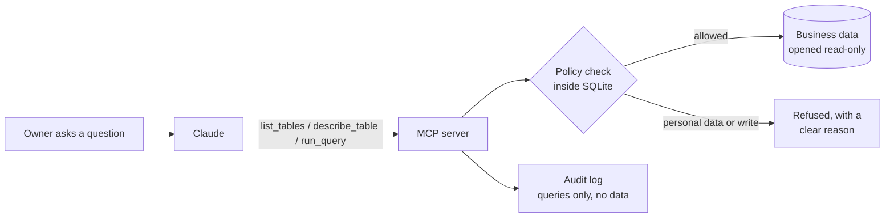

# Business Data Assistant

**Ask an AI questions about your business, answered from your real numbers, without handing it your customers' personal data.**

> "How did September compare to August?"
> "Which wholesale accounts pay late?"
> "Butter costs feel higher. How much is it hurting margin?"

This is a working demo of an [MCP](https://modelcontextprotocol.io) server that connects Claude (or any MCP-capable assistant) to a small business's sales, payments, invoices and expenses. The assistant can explore and query the data itself. It **cannot change anything**, and it **cannot read personal data**, however the question is phrased.

The sample business is *Juniper & Rye*, a fictional bakery with 21 months of generated data: 22,000 orders, card payments with processor fees, wholesale invoices, and monthly expenses.

**See it in action:** [example session](demo/SESSION.md). Four real questions, every answer backed by real tool calls, including two requests that hit personal data and were blocked.

## How it works



The assistant gets three tools:

| Tool | What it does |
|---|---|
| `list_tables` | Lists the tables it can query |
| `describe_table` | Shows columns and types, and marks which are blocked |
| `run_query` | Runs one read-only SQL `SELECT` and returns up to 200 rows |

## Security model

The protections live in the database connection, not in the prompt. A cleverly worded question, or a model mistake, can't talk its way past them.

1. **Read-only at the file level.** The database is opened with `mode=ro`, so even a bug in the policy code can't write.
2. **Column-level blocking, enforced by SQLite.** A [SQLite authorizer](https://www.sqlite.org/c3ref/set_authorizer.html) checks every column read. Personal-data columns (customer name, email and phone; wholesale contact name and email) are denied wherever they appear: in `SELECT *`, `WHERE email LIKE ...`, subqueries, CTEs, joins, `COUNT(DISTINCT phone)`, `length(email)`. Filtering counts as reading, so the model can't guess values one character at a time.
3. **Only `SELECT`.** Inserts, updates, deletes, `DROP`, `ATTACH`, `PRAGMA`, extension loading and multiple statements are all refused.
4. **Bounded cost.** Results are capped at 200 rows, and runaway queries are interrupted after 2 seconds.
5. **Audit trail.** Every query is logged with time, SQL, outcome and row count, including which column a blocked query tried to read. The log never contains returned data. ([sample](demo/audit-sample.jsonl))

The policy is one file, [`assistant/policy.py`](assistant/policy.py). Changing what's blocked doesn't touch any other code.

## Run it

Requires Python 3.12+ and [uv](https://docs.astral.sh/uv/).

```bash
uv sync
uv run python -m assistant.seed      # builds data/bakery.sqlite
uv run pytest                         # 25 tests, all offline
```

**Connect it to Claude Code:**

```bash
claude mcp add business-data -- uv run --directory "$PWD" python -m assistant.server
```

**Or to Claude Desktop:** add the server to `claude_desktop_config.json`:

```json
{
  "mcpServers": {
    "business-data": {
      "command": "uv",
      "args": ["run", "--directory", "/path/to/ai-data-assistant", "python", "-m", "assistant.server"]
    }
  }
}
```

Then ask it something like *"What were our best and worst months, and why?"*

## Tests

25 tests ([`tests/test_safe_db.py`](tests/test_safe_db.py)) cover:
- normal business queries and joins that work,
- nine different ways of trying to reach personal data, all blocked,
- eight kinds of write or escape attempts, all refused,
- multi-statement injection,
- row caps and runaway-query timeouts,
- an audit log that records questions but not answers,
- a check that the database file is byte-for-byte unchanged after attempted writes,
- the MCP server end to end: tool listing, and errors returned as data, not leaked rows.

## Using this with a real business

The demo uses SQLite so it runs anywhere in one command. A production setup follows the same design with sturdier parts:

- **Data source:** a read-only replica or reporting database (Postgres, for example) with a dedicated read-only role. Personal data is excluded with column privileges or views at the database level, the same idea as the authorizer here.
- **Getting the data:** sync from the tools the business already uses, such as Stripe, Square, Shopify, QuickBooks or a CRM, into that reporting database on a schedule.
- **Access:** hosted behind single sign-on, so only staff can use it, with the audit log shipped somewhere durable.
- **Policy review:** the business decides which columns the assistant can see. The default is to block anything that identifies a person.

---

Built by Max Robbins: senior full-stack engineer (Rails, React, Python, Django). I build automations and secure AI tools for small businesses.
